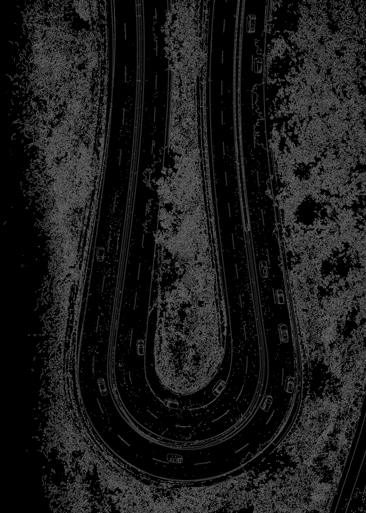
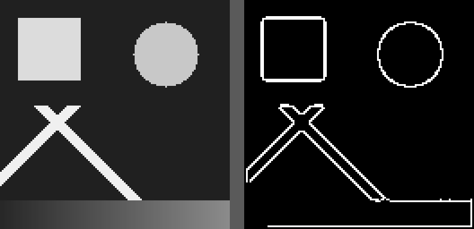
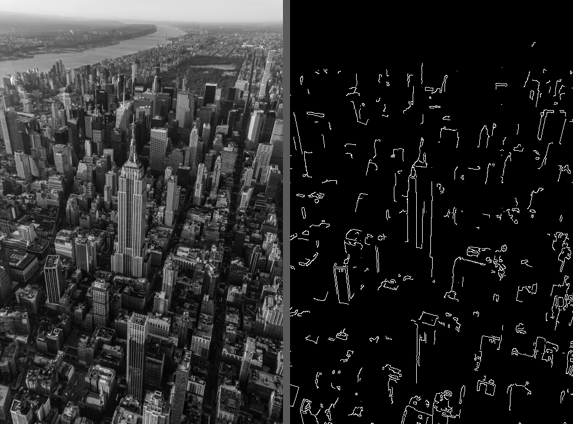

# fpga-canny-bitexact

**A complete Canny edge detector in Verilog on a low-cost Artix-7 FPGA, verified
bit-exact against a Python golden model, in simulation and on the board.**

Most FPGA "Canny" designs stop at Sobel plus a threshold, or approximate the last
stage. This one implements every stage, including the **iterative hysteresis**
edge tracking, and matches the software reference pixel for pixel.

<p align="center">
  
  <br>
  <em>1:1 detail crop: original photograph (left), FPGA output (right). Colour
  images are converted to grayscale on the host before they are sent.</em>
</p>

---

## Results

| Metric | Value |
|---|---|
| **FPGA vs Python model, on the board** | **0 of 345,600 pixels differ** (480 × 720 image, 24 tiles) |
| **RTL vs Python model, in simulation** | **0 pixels differ on all 5 stages**, hysteresis iteration counts identical (7 test cases) |
| Largest image processed on the board | 3807 × 5330 (20.3 MP) in 4 min 33 s |
| 4K image (3840 × 2160) | 110 s end to end |
| FPGA compute per 128 × 128 tile | 1.65 – 28.42 ms at 50 MHz, set by the number of hysteresis passes |
| Resources | 29 / 50 BRAM36, ~780 LUTs, 2 DSP |
| Clock / link | 50 MHz, UART at 2 Mbaud (exact divisor, 0% baud error) |
| Target | Xilinx Artix-7 `xc7a35tftg256-1` (EDGE Artix-7 board) |

The bit-exact match is the important number. Line buffers, the integer
gradient-direction quantiser, non-maximum suppression and up to 256 hysteresis
iterations all reproduce the reference model **exactly**. A single clock of
misalignment anywhere in the pipeline would show up as a shifted image.

<p align="center">
  
  
  <br>
  <em>20.3 MP aerial photograph processed on the FPGA as 1440 overlapping tiles
  and stitched back together.</em>
</p>

---

## How it works

```
 Host PC (Python)                               FPGA (Artix-7, 50 MHz)
 ─────────────────                              ──────────────────────
 any image ─> grayscale ─> 128×128 tiles ──UART──> uart_rx ─> m_in (BRAM)
                          (4-pixel halo)                           │
                                                 P1 Gaussian 3×3   ▼
                                                 P2 Sobel  ──> magnitude + direction
                                                 P3 non-maximum suppression
                                                 P4 double threshold  (0 / 128 / 255)
                                                 P5 hysteresis, repeated until
                                                    nothing changes (cap 256)
 stitch tile cores ─> PNG  <──────────UART────── uart_tx <─────────┘
```

- **Five passes over Block RAM frame buffers**, sequenced by `canny_core.v`.
  All five operators share one 3×3 window generator and all have exactly
  **2 clocks of latency**, so validity is tracked once for the whole core.
- **No square root, no `atan`, no division.** Magnitude is `(|Gx| + |Gy|) >> 2`;
  direction is an integer tangent comparison against Q8 constants 106/256
  (tan 22.5°) and 618/256 (tan 67.5°).
- **Real hysteresis.** A weak pixel is promoted only if it touches a strong one,
  and that promotion travels along the edge chain. That cannot be done in a single
  streaming pass, so the tile lives in BRAM and hysteresis runs as repeated
  full-tile passes, ping-ponging between two buffers until a pass promotes
  nothing.
- **Tiling with a 4-pixel halo.** Each pass zeroes its 1-pixel border and that
  contamination spreads inward one ring per pass, to a depth of exactly 3. A halo
  of 4 therefore makes every tile's core **bit-identical** to processing the whole
  image for blur, Sobel, NMS and threshold.
- **Thresholds travel in the UART header**, so changing them needs no rebuild.

**Full walkthrough:** [docs/ARCHITECTURE.md](docs/ARCHITECTURE.md) (dataflow, module
hierarchy, pipeline timing).
**Why each value is what it is, with the measurements:**
[docs/DESIGN_NOTES.md](docs/DESIGN_NOTES.md).

---

## Verification

Three levels, all reproducible:

**1. Golden model.** [`model/canny_model.py`](model/canny_model.py) mirrors the RTL
exactly: same shifts, same integer truncation, same border handling, same
iteration cap.

**2. RTL simulation regression.** [`sim/run_regression.py`](sim/run_regression.py)
runs `canny_core` in Icarus Verilog and compares **every intermediate stage**
against the model. It also runs in GitHub Actions on every push.

```bash
python sim/run_regression.py
```
```
case                    blur   mag   nms   cls final  iters rtl/model  compute ms @50MHz
pattern_25_60              0     0     0     0     0       38/38                   13.88
pattern_50_100             0     0     0     0     0       65/65                   22.80
photo_topleft_20_40        0     0     0     0     0       46/46                   16.52
photo_middle_20_40         0     0     0     0     0       82/82                   28.42
photo_middle_50_100        0     0     0     0     0       65/65                   22.80
noise_20_40                0     0     0     0     0        5/5                     2.97
flat_255_20_40             0     0     0     0     0        1/1                     1.65
PASS -- RTL is bit-exact with canny_model.py on every stage
```

**3. On the board.** `--cmd N` returns any internal buffer (blur, magnitude, NMS,
threshold) over UART, so a mismatch points to one pass instead of "the design".
`--selftest` round-trips a known pattern through the frame buffer first, to prove
the link before blaming any image-processing bug on it.

<p align="center">
  
  <br>
  <em>Synthetic test pattern: square (0°/90°), circle (all directions), 45° and
  135° bars, and a smooth ramp that must produce no edges.</em>
</p>

<p align="center">
  
</p>

---

## Repository layout

```
├── fpga/                   everything that goes into Vivado
│   ├── README.md           files to add, pinout, expected utilisation
│   ├── rtl/                11 Verilog-2001 files, no vendor IP
│   └── xdc/canny.xdc       pin constraints
│
├── model/                  bit-exact golden model
│   ├── canny_model.py      Python model of the RTL
│   └── mktest.py           synthetic verification pattern
│
├── sim/                    RTL regression (Icarus Verilog)
│   ├── tb_core.v
│   └── run_regression.py
│
├── host/                   PC side
│   ├── fpga_link.py        send image / receive edges over UART  <- the one you run
│   ├── tile_canny.py       software reference on a full image, with --compare
│   └── raw2png.py          .hex -> PNG
│
├── docs/
│   ├── ARCHITECTURE.md     design walkthrough
│   └── DESIGN_NOTES.md     design decisions and the measurements behind them
└── image.bmp               small sample image (480 × 720)
```

---

## Run it

### Simulation only (no board)

Needs Python 3 with `numpy` and `pillow`, and `iverilog` + `vvp` on PATH
(e.g. from [OSS CAD Suite](https://github.com/YosysHQ/oss-cad-suite-build)).

```bash
pip install numpy pillow
python sim/run_regression.py                        # RTL vs model, every stage
cd host
python tile_canny.py ../image.bmp --tlow 20 --thigh 40  # software reference -> data/canny_tiled.png
```

### On the board

**Build.** In Vivado, create an RTL project for `xc7a35tftg256-1`, add all files in
`fpga/rtl/`, set `top.v` as top, add `fpga/xdc/canny.xdc`, and generate the
bitstream. Expect positive WNS at 50 MHz. Any Artix-7 board with a UART works:
change the pins in `canny.xdc`. Details in [fpga/README.md](fpga/README.md).

| Signal | Pin | Note |
|---|---|---|
| `clk` | N11 | 50 MHz |
| `uart_txd` | C4 | FPGA → PC |
| `uart_rxd` | D4 | PC → FPGA |
| `rst_btn` | M14 | active high; optional (there is a power-on reset) |
| `led[3:0]` | J3 H3 J1 K1 | rx / processing / tx / error |

**Run.**

```bash
pip install pyserial pillow numpy
cd host
python fpga_link.py --port COM3 --selftest                       # 1. prove the link
python fpga_link.py ../image.bmp --port COM3 --tlow 20 --thigh 40   # 2. full image
```

The output is written to `data/fpga_final.png`. Any image size and any
PIL-readable format works; colour is converted to grayscale and partial edge
tiles are padded by replication.

| Flag | Effect |
|---|---|
| `--selftest` | UART echo test, no image processing |
| `--tile N` | process one tile only (quick bring-up) |
| `--cmd 3\|4\|5\|6` | return blur / magnitude / NMS / threshold instead of the final edges |
| `--tlow` `--thigh` | hysteresis thresholds, sent at runtime |
| `--baud` | must match `BAUD` in `top.v` (default 2 000 000) |

**Choosing thresholds.** Sobel is a local 3×3 operator, so what counts is the
gradient *per pixel*. Heavily downscaled images suit **50 / 100**; native
multi-megapixel photos suit **20 / 40**. Since the model is bit-exact, tune in
software with `tile_canny.py` first.

---

## Limitations

- **Tile seams in hysteresis.** Blur, Sobel, NMS and threshold are bit-exact per
  tile, but hysteresis cannot see a strong pixel far outside the tile. Measured
  difference against whole-image processing: 0.815%, with no visible seams.
  A 16-pixel halo only improves this to 0.719% for 67% more traffic.
- **The UART link is the bottleneck, not the FPGA.** About 164 ms per tile on the
  link against at most 28 ms of compute.
- **One global threshold pair**, which is a limitation of Canny itself.
- This is not faster than a CPU on stored images. The point of the hardware is
  a fixed, predictable pipeline that can sit next to a sensor.

---

## Where this is going

This is the first module of a larger idea: a normal CPU stays the master, and
small hardwired FPGA modules handle always-on, time-critical jobs, the way
reflexes work. Work in progress:

- a **streaming camera → VGA** version on the same board (OV7670 in, edges out,
  no frame buffer round trip);
- turning streaming edges into **spikes** for a small spiking (LIF) layer on the
  same FPGA, so the CPU is only woken when something matters.

---

## Author

**Raj Mali**, VLSI / FPGA. Questions and feedback are welcome via GitHub issues.

## License

MIT, see [LICENSE](LICENSE).
