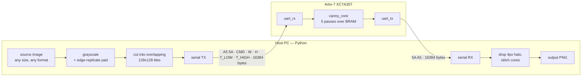
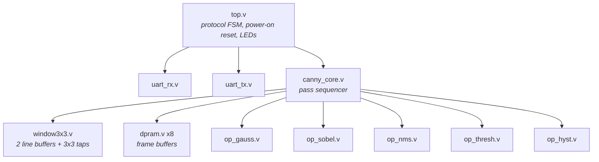
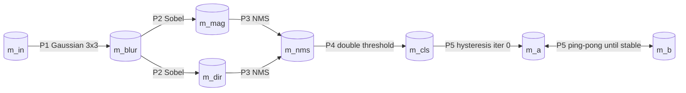
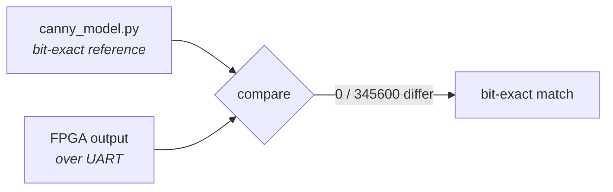

# Architecture

A design walkthrough of `verilog-canny-pipeline`: how the data moves, why the
structure is what it is, and where the non-obvious constraints are.

---

## 1. System overview

The FPGA processes exactly one fixed-size 128×128 frame at a time. Everything to
do with arbitrary image sizes lives on the host — the RTL never knows the source
image was 20 megapixels.



**Why this split.** Keeping the frame size fixed in hardware means the address
generator, the window generator and every buffer are sized at synthesis time —
no dynamic addressing, no variable-latency logic. All the flexibility costs
nothing in gates because it lives in Python.

---

## 2. Module hierarchy



All five operators are instantiated **in parallel** and share one window
generator. Only one is selected per pass; the others compute discarded values.
This costs under 1000 LUTs total and makes the control logic trivial — there is
one address generator, one window generator, and one output mux, rather than five
separate datapaths to sequence.

Every operator has **exactly 2 clocks of latency**, so `canny_core` tracks
validity once for all of them instead of per-operator.

---

## 3. The five passes

Canny does not fit a single streaming pipeline, because hysteresis propagates
along edge chains without bound. So the frame lives in Block RAM and each stage
is a separate raster pass:



### P1 — Gaussian blur
`(p00 + 2·p01 + p02 + 2·p10 + 4·p11 + 2·p12 + p20 + 2·p21 + p22) >> 4`

Every weight is a power of two — shifts and adds only, no multiplier.

### P2 — Sobel magnitude and direction

```
Gx = [-1 0 1; -2 0 2; -1 0 1]      Gy = [-1 -2 -1; 0 0 0; 1 2 1]
mag = min(255, (|Gx| + |Gy|) >> 2)
```

No square root — `|Gx|+|Gy|` is the standard approximation (under 12% error).

Direction needs no `atan` and no divide. With `ax=|Gx|`, `ay=|Gy|` and Q8
constants `tan(22.5°) ≈ 106/256`, `tan(67.5°) ≈ 618/256`:

| Condition | Direction | NMS compares |
|---|---|---|
| `ay·256 ≤ ax·106` | 0° | W / E |
| `ay·256 ≥ ax·618` | 90° | N / S |
| `sign(Gx) == sign(Gy)` | 135° | NW / SE |
| otherwise | 45° | NE / SW |

Flat regions give `ax=ay=0`, which satisfies the first test and yields direction
0. Harmless — magnitude there is 0, so NMS emits 0 regardless.

Both constant multiplies synthesise to small adder trees (106 = 64+32+8+2,
618 = 512+64+32+8+2).

### P3 — Non-maximum suppression
Thins ridges to single-pixel edges: the centre survives only if it is ≥ both
neighbours **along the gradient direction**, else it is suppressed to 0.

The direction buffer is read on a second port, issued one pipeline stage early so
its output lands in the same cycle as the registered window.

### P4 — Double threshold
`≥ T_HIGH → 255` (strong), `≥ T_LOW → 128` (weak), else `0`.
Pointwise, but still routed through the shared window path so it inherits the
same border zeroing and the same 2-clock latency.

### P5 — Hysteresis (the part that makes this Canny)
A weak pixel (128) touching any strong pixel (255) in its 8-neighbourhood is
promoted. Because promotion advances only **one pixel per iteration** along a
chain, the pass repeats — ping-ponging `m_a` ↔ `m_b` — until an iteration promotes
nothing, or until a hard cap of 256.

Surviving weak pixels are mapped to 0 **at read-out**, not in an extra pass, which
keeps the pre-hysteresis classification inspectable over UART (`CMD 0x06`).

Measured convergence: 18 (128×128 crop) · 82 (worst tile, 480×720) · 89 (synthetic
pattern) · 189 (1920×1080).

---

## 4. Pipeline timing

This is the part that breaks silently if it is wrong — a one-cycle error shifts
the whole image by a pixel and still *looks* like a plausible edge map.

```
cycle   stage
  0     fetch presents read address
 +1     BRAM dout valid            -> window3x3 in_vld
 +2     window3x3 tap stage        (line-buffer outputs registered)
 +3     window3x3 window registers -> win_vld / win_addr / win_border
 +4     alignment stage            -> m_dir dout lands here too
 +5     operator stage 1
 +6     operator stage 2           -> write, address = wa2
```

The window centre lags its input by `W+1` pixels, so each pass feeds
**`N + W + 1`** samples — `N` real pixels then `W+1` zeros — to flush all `N`
windows out the far end.

Write address and border flag are carried down a matching 2-deep delay so they
arrive with the operator result.

### Border handling
Each pass forces its 1-pixel border to 0. This also neatly covers the cases where
the sliding window straddles a row boundary and holds wrapped-around pixels —
those are exactly the `x=0` and `x=W-1` positions that get zeroed anyway.

---

## 5. Memory

Line buffers are forced to distributed RAM so they do not consume Block RAM.

| Buffer | Width | BRAM36 | Purpose |
|---|---|---|---|
| `m_in` | 8 | 4 | raw tile from UART |
| `m_blur` | 8 | 4 | Gaussian output |
| `m_mag` | 8 | 4 | gradient magnitude |
| `m_dir` | 2 | 1 | quantised direction |
| `m_nms` | 8 | 4 | after NMS |
| `m_cls` | 8 | 4 | after double threshold |
| `m_a` | 8 | 4 | hysteresis ping |
| `m_b` | 8 | 4 | hysteresis pong |
| **Total** | | **29 / 50** | **58%** |

### Why the frame is 128×128 and not larger

BRAM allocation granularity, not total capacity. A depth-16384 8-bit buffer maps
to 4 BRAM36 in 16K×2 mode. Depth 32768 needs 32K×1 mode — **8** BRAM36 per
buffer, so 7 buffers would need 56 and the design would not fit.

| Frame | One buffer | 7 buffers + dir | Verdict |
|---|---|---|---|
| 128×128 | 16 KB | 116 KB | fits — 29 BRAM36 |
| 160×160 | 25 KB | 181 KB | 51 BRAM36, over budget |
| 640×480 | 300 KB | 2175 KB | one buffer alone exceeds all 225 KB |

640×480 would require external SDRAM. The board has a 256 **Mbit** (32 MB) part,
which is enough for whole-image processing up to 1080p — but see §7.

---

## 6. Tiling: why the halo is exactly 4

Each pass zeroes its 1-pixel border, and that contamination spreads inward one
ring per pass:

```
gaussian   -> ring 0 forced to 0
sobel      -> ring 1 corrupted (it reads the zeroed ring 0)
nms        -> ring 2 corrupted (it reads the corrupted ring 1)
threshold  -> pointwise, spreads nothing
```

Contamination depth is exactly **3**. Any `HALO ≥ 4` therefore makes each tile's
core **bit-identical** to whole-image processing for blur, Sobel, NMS and
thresholding.

```
        128 px tile
   ┌───────────────────┐
   │ ░░░░░░░░░░░░░░░░░ │  ░ = 4px halo, discarded
   │ ░ ┌───────────┐ ░ │
   │ ░ │  120x120  │ ░ │  █ = core, kept and stitched
   │ ░ │   core    │ ░ │
   │ ░ └───────────┘ ░ │
   │ ░░░░░░░░░░░░░░░░░ │
   └───────────────────┘
```

Hysteresis is the exception — it propagates without bound, so a tile can never
know about a strong pixel far outside it. Measured against a whole-image
reference:

| HALO | CORE | tiles (480×720) | UART bytes | diff vs whole image |
|---|---|---|---|---|
| **4** | **120** | **24** | **786 K** | **0.815%** |
| 8 | 112 | 35 | 1147 K | 0.761% |
| 16 | 96 | 40 | 1311 K | 0.719% |

Quadrupling the halo buys 0.1% for 67% more traffic. The flat curve confirms the
residual is inherent to tiling hysteresis, not a halo-size problem.

Edge tiles are padded by **replication**, never zeros — zero padding would
manufacture an enormous artificial gradient and ring the image with false edges.

### Larger tiles do not help

Bigger tiles waste less on the halo but fit image dimensions worse, and the two
effects cancel almost exactly:

| Tile | Halo efficiency | Edge efficiency | Overall |
|---|---|---|---|
| 128 | 87.9% | **100.0%** | 87.9% |
| 256 | 93.8% | 93.7% | 87.9% |
| 320 | 95.1% | 93.6% | 89.0% |

(For 3840×2160, core 120 divides both dimensions exactly — 32 × 18 — so there is
zero edge waste at the current size.)

---

## 7. Where the time goes

| Stage | Per 128×128 tile |
|---|---|
| UART receive (16 KB @ 2 Mbaud) | 82 ms |
| **FPGA compute (5 passes + hysteresis)** | **26 ms** |
| UART transmit (16 KB) | 82 ms |

**The link is the bottleneck by 6×.** This is why external SDRAM would not make
the system faster — it would enable whole-image processing and remove tile seams,
but the serial transfer would still dominate.

The two levers that do work:

- **Baud rate.** 115200 → 2 Mbaud took a 4K image from 27 min 36 s to 110 s.
  2 Mbaud divides exactly on both sides (50 MHz/25 and 48 MHz/24 in the FT2232H),
  so there is zero baud error.
- **Packing the output 1 bit per pixel.** The final result is binary, yet 8 bits
  per pixel are returned. Packing would cut total traffic 44%. Not implemented.

---

## 8. UART protocol

**PC → FPGA**

| Bytes | Field |
|---|---|
| 2 | magic `A5 5A` |
| 1 | `CMD` |
| 2 | width, little-endian |
| 2 | height, little-endian |
| 1 | `T_LOW` |
| 1 | `T_HIGH` |
| W×H | pixels, raster order |

**FPGA → PC:** magic `5A A5`, then W×H bytes.

Width and height are checked against the synthesis parameters; a mismatch lights
`led[3]` rather than silently producing garbage. The magic bytes let the host
resynchronise instead of returning shifted data after a lost byte.

### CMD — the debugging backbone

| CMD | Returns |
|---|---|
| `0x01` | final Canny result |
| `0x02` | `m_in` echo — proves the link with zero processing |
| `0x03` | after Gaussian |
| `0x04` | gradient magnitude |
| `0x05` | after NMS |
| `0x06` | after double threshold |

Because thresholds travel in the header, tuning them requires **no
re-synthesis**. Because any internal buffer can be dumped, a wrong output
localises to a single pass instead of "the design is broken".

---

## 9. Verification strategy



`host/canny_model.py` is not "a Canny implementation" — it is an
operation-for-operation mirror of the RTL: same shift amounts, same integer
truncation, same integer tangent comparison, same zeroed borders, same iteration
cap. Any difference between it and the hardware is a bug in one of them.

That turns verification from *"does this look like edges?"* into a byte
comparison, and it is how both the `>>2` magnitude shift and the 256-iteration cap
were found — each of which would otherwise have been a silent, plausible-looking
defect.

Escalating checks:

1. `--selftest` — UART echo, isolates the link
2. `--tile N --cmd 3..6` — per-stage dump, isolates the failing pass
3. full image vs `tile_canny.py` — end-to-end byte comparison
